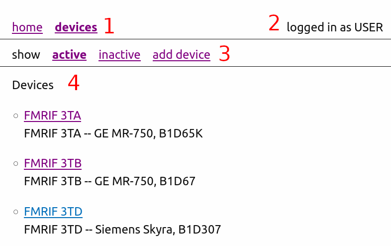
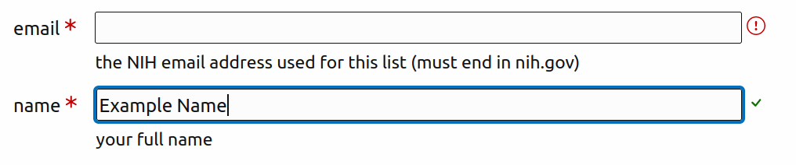
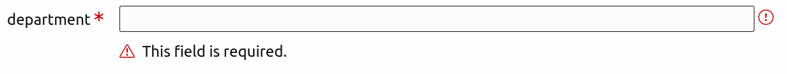
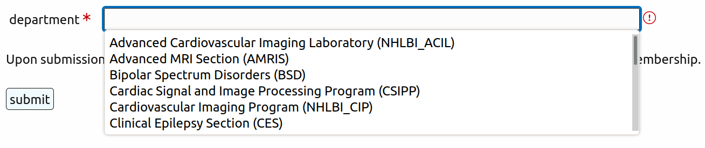
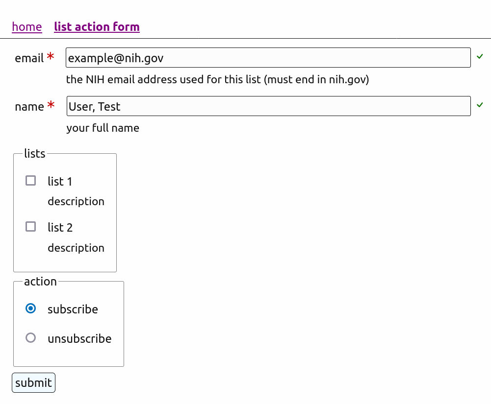
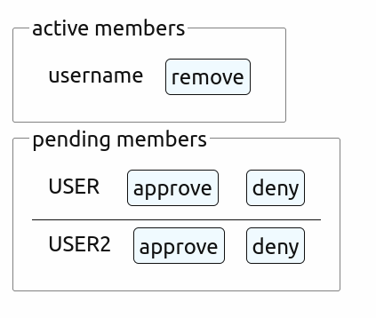
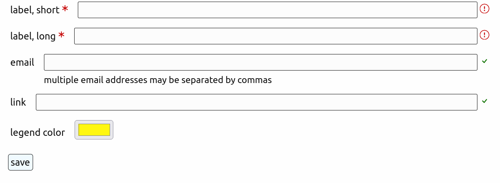
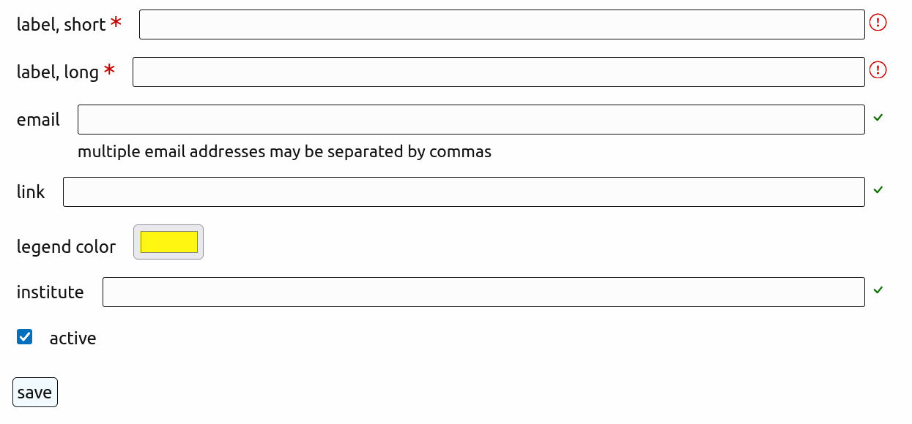
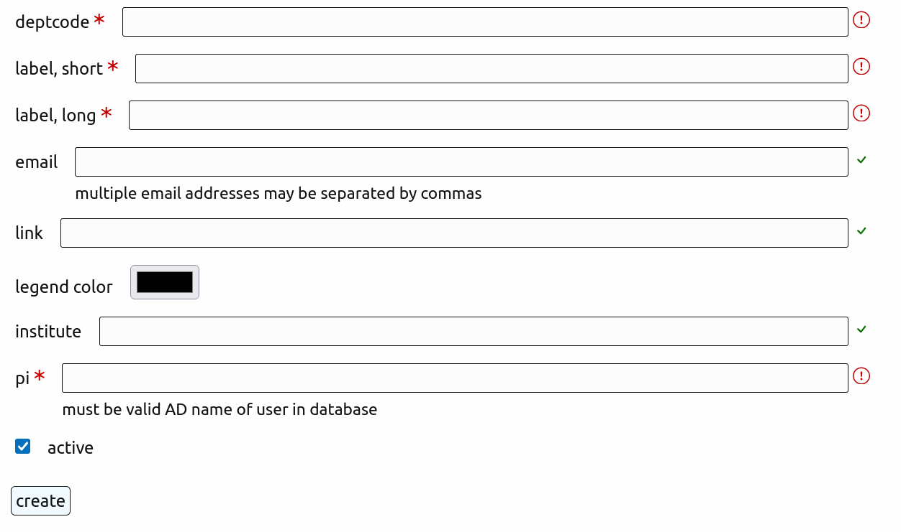

---
title: Scanner Scheduler User Manual
lof: true
...
\pagebreak
# Common elements

There are a number of common design elements used on the site that will be briefly discussed. These will likely be familiar from other websites and this section is meant as a quick orientation to the particulars of this site.

{ width=100% }

1. The **breadcrumb** shows your position in the hierarchical structure of the site
2. The **user information** shows the username of the currently logged in user
3. The **tabs** show links to other pages in the current section
4. The **content area** shows the content of the current page

Both the breadcrumb and the tabs denote the current page with bold typeface. If there is only one page available to you in the current section, the tabs will not be shown.

\pagebreak
{ width=100% }

The red asterisk next to the label marks a field as required.

The smaller text below the input field provides additional description or help.

The blue ring around the second input shows which form element is currently active.

After the input field there is a validation status icon:

* a circled red exclamation point means the input is currently invalid and the form cannot be submitted
* a green checkmark indicates that the input is currently valid

{ width=100% }

Not all errors can be checked before the form is submitted to the server. If the server detects the error, the form will be returned with additional errors noted in the description. The errors are marked by a red exclamation point in a triangle.

\pagebreak
{ width=100% }

Many fields autocomplete. Depending on the browser, clicking or double clicking a field will open the autocomplete. Otherwise begin typing and relevant options will be displayed and winnowed as you continue. The options in these fields will be of the form "human label (computer id)" and while both can be used in the autocomplete only the computer id portion is valid. For example, in the autocomplete pictured above you could start to type "pol" and "Bipolar Spectrum Disorder (BSD)" would be shown in the autocomplete. Selecting it will fill the field with "BSD". You could also have typed "BSD" directly and ignored the autocomplete's drop down.

\pagebreak
# The home page

The home page is a list of the main sections of the site.

1. [devices](#devices)
2. [groups](#groups)
3. [join form](#join-form)
4. [list action form](#list-action-form)

The [*groups*](#groups) section will only be shown if your account has access to it.

These sections will be explored from bottom to top. Many have subsections that only apply to users with higher administrative rights. If you do not see the links to an area being discussed, you can skip that portion of the documentation.

\pagebreak
# list action form
{ width=100% }

The list action form allows you to subscribe or unsubscribe from mailing lists relevant to this domain.

Your name and email will be populated from your login, but can be edited. Check the boxes in the lists to subscribe to/unsubscribe from (at least one must be selected). Then select the desired action.

\pagebreak
# join form

This form has a single autocomplete for all groups that you are not a member of currently. To request joining a group, use the autocomplete to select it and submit the form. Upon submission of this form, the primary investigator (**PI**) of the department will be emailed to confirm your membership.

The admin group has special protections and can only have members added by someone with direct access to the server. See cli.pdf for more information.

If you are a member of the DEV group but not a technologist, there will be a second page listed in the tabs. This page lets you attest to your qualification to be a technologist. However, the DEV PI must also assign you to devices as a technologist for you to be able to handle technology requests on those devices.

\pagebreak
# groups

Once you have been approved for at least one group, you can see the groups page. It will list all groups that you are a member of. Admins will see all groups as well as an option to see a list of groups that are no longer active and an option to add new groups.

A regular user will only be able to see basic information about the group and a list of fellow members. PI and admin will see additional tabs to alter membership, change the PI, and edit the group. These will be discussed in the following subsections. Regular users should skip ahead to the section on [*devices*](#devices).

\pagebreak
## membership

{ width=100% }

This page allows PI to remove members from their group. The PI is not listed on this page as the PI cannot be removed from the group. If there are pending members, they can be approved or denied from here (or from links in the notification email sent when the user submits the join form).

## change PI

This page has an autocomplete for approved members who are not currently the PI. If submitted, the designated member is the new PI and the old PI is a regular member, who can then be removed by the new PI if necessary.

## edit

{ width=100% }

{ width=100% }

The edit form has extra fields for admins.

The labels are used to describe the group to humans. The computer will always used the *deptcode* which is not editable.

The email or emails are used for any group notifications. The link is for other group members.

The legend color is the color this group will use in the scheduler. The color selection box is provided by the browser.

Admins can additionally change the institute associated with a group and uncheck the active box to make the group inactive.

## add group

{ width=100% }

The add group form is much like the group edit form but with two additional fields:

The deptcode field sets the id that this device will use for internal references.

The PI field selects an active user to be made the initial PI of the group. This is not an autocomplete as there are too many candidates. The username selected to be the PI must have been logged into the site at least once to be considered valid. An admin can always choose to make themselves PI and then use the change PI form later once the actual PI has joined the group.

\pagebreak
# devices

The devices page lists all active devices. Each is linked to the relevant [*device*](#device-schedule)

## inactive devices

This tab lists all archived devices.

## add device

This tab allows creation of a new device.

The scannercode is the id used on the schedule and the label is the friendlier name listed on the device page. The optional description is listed below the label.

The email is the device mailing list where updates to the schedule are posted.

The technologist, medical, and training emails are for support requests. They may be left blank if there are no support users for that category.

The active checkmark determines whether the device will be active or inactive.

# device schedule

TODO 

The remainder of this document applies to users with additional privileges (PI, admins, and device group members) and users without may end here.

## device groups

This tab lists the groups assigned to this device. Groups assigned to this device may be scheduled on this device and members of those groups may modify the schedule for this device following the regular rules.

Each device listed has an option to be removed from the device.

## add group to device

Add group provides an autocomplete for adding an existing group to the device. Once added that group is listed under [*groups*](#add-group-to-device).

## device users

The users tab consists of two lists:

- users in the DEV group assigned to this device
- users in the DEV group not assigned to this device

In either case you can click the user's name to modify their relation to the device.

If the user is assigned to the device at least one checkmark will be checked and there will be a button to "remove from device".

If the user is not assigned no checkmarks will be checked. To assign an unassigned user check at least one checkmark and save.

The meaning of each checkmark is as follows:

**use and apply templates**: this user will have access to the templates subsection on this device and be able to manage and apply templates on this device.

**edit any slot**: this user will be able to edit slots in the past, in the off hours, and for groups that they do not belong to.

**respond to medical requests**: this user will be a valid handler for medical requests. Medical requests will not be an option on this device unless at least one user has this permission.

**respond to training requests**: this user will be a valid handler for training requests. Training requests will not be an option on this device unless at least one user has this permission. 

**respond to technologist requests**: this user will be a valid handler for technologist requests. Technologist requests will not be an option on this device unless at least one user has this permission. This option is only available for users that have completed the [*technologist join form*](#join-form).

## device edit

The device edit page is the same as the [*add device*](#add-device) page except that the scannercode may not be edited.

\pagebreak
# templates

## template application

The templates field takes an ordered list of template codes. As a convenience above this field there are buttons for each active template. Clicking one of these buttons appends that templatecode to the end of the templates field, but this is no different than typing the same code in the field. Template codes may be repeated.

Applying the templates will in turn append a copy of each template to the schedule, starting at the end of the current schedule whose date is noted on the page. For example, if the templates listed as "apple", then the entries of template "a" will be applied to the schedule, then the entries of "p", then the entries of "p" again, then the entries of "l", then the entries of "e".

Before they are applied all the templates are checked for validity. A template is valid if all the groups on the template are groups of device and all members in the template are members of the respective groups. If this check fails, no templates will be applied. Before trying again the invalid templates must be updated using the [*schedule*](#schedule) tab to correct the errors.

## active and inactive templates

These tabs list the active and inactive templates, respectively, of the device.

### schedule

The schedule tab edits the entries of the template. It is very similar to the [*device schedule*](#device-schedule) editor. The major differences are that it is for a fixed one week period, there is an institute field, and there are no support requests.

### metadata

The metadata tab allows you to edit the information about this template. The label and description are those listed in the active/inactive tabs. The archived checkbox makes the template inactive.

## add template

Add template allows you to create new templates. It is similar to [*metadata*](#metadata) with two additional fields.

The templatecode is the code used in [*template application*](#template-application).

The other is an optional clone field. If left blank, the new template will have all blank fields for every entry. If given the templatecode to another template (active or inactive), the newly created template will have a copy of that template's entries.